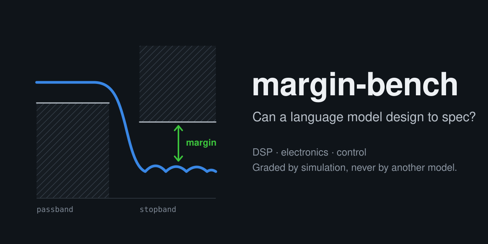

<p align="center"></p>

# margin-bench

Can a language model run a plant?

margin-bench gives a model a simulated plant and the tools an engineer would have: it can drive a valve,
tune a controller, build a signal chain, look at trends, spectra and scope traces, and put known weights
on a scale. It works on the plant as long as it needs, then hands over. An acceptance test on the plant
decides, by simulation only, never by another model.

Every run can be replayed on the site, step by step: the plant animation, every tool call and the data
it returned, the messages and reasoning the model shares, wall time, tokens and cost. A run can also be
watched live while the model works.

**Site:** https://takzen.github.io/margin-bench/

[](https://github.com/takzen/margin-bench/actions/workflows/tests.yml)

**Status:** five environments, `process.tank_level`, `process.inline_heater`, `control.dc_motor`,
`control.cart_pendulum` and `dsp.scale_readout`. One more is on the way: a circuit with a fault.
No model has been run yet; the site shows the scripted agents.

## How an environment works

* **A plant, not a quiz.** Each environment is a simulated plant whose parameters come from a seed and
  are hidden from the model. The model only learns what it measures.
* **Tools.** The model acts through function calls. Plant time moves only when a tool lets it run, so
  thinking costs wall time, not plant time. Each environment has a budget of plant time and tool calls.
* **Acceptance test.** After `submit`, the environment runs a fixed test on a fresh copy of the plant
  with whatever the model left (a tuning, a signal chain) and checks written requirements, stated in
  the prompt. Each requirement gives a ratio that reaches 1 exactly when it is met; the score is the
  smallest one, so 1.000 means every requirement was met.
* **Each environment proves itself.** A scripted reference engineer, working only through the same
  tools, passes every seed, and scripted known-bad approaches fail every seed. The test suite checks
  both on 20 seeds.
* **Difficulty from design rules.** The limits of an acceptance test come from a family of textbook
  designs run on the true plant, never from any model's score.

## Environments

### `process.tank_level`: commission a level loop

A vertical tank, filled through a control valve and drained by gravity, so the outflow follows the
square root of the level and the downstream demand. The level transmitter reads through a transport
delay and adds noise; the valve actuator has its own lag. A PID block (sample time 0.5 s, ideal form,
percent of span) drives the valve. Tank size, valve size, delays and noise come from the seed and are
not told to the model.

The model gets these tools:

| Tool | What it does |
|---|---|
| `set_manual(valve_percent)` | controller to manual, valve output by hand |
| `set_auto(setpoint_m)` | controller to automatic (or a new setpoint) |
| `set_tuning(kc, ti_s, td_s, pv_filter_s, anti_windup)` | change any controller parameter |
| `set_outlet_demand(percent)` | ask operations to change the draw, 30 to 80 % |
| `wait(seconds, sample_s)` | let the plant run and return the trend |
| `submit()` | hand over for the acceptance test |

It has four hours of plant time and 40 tool calls. Plant time moves only when the model lets it run,
so thinking costs wall time, not plant time. Reaching the high-high (spill) or low-low (dry pump) alarm
while commissioning counts against it.

The acceptance test runs with the tuning the model left: the tank starts low, the controller switches
to automatic with setpoint 1.20 m, then the outlet demand steps up and down. The requirements, given
in the prompt, are: no alarm, inside 1.20 ± 0.03 m within a time limit and staying there, a maximum
overshoot, recovery into the band within a time limit after each demand step, and a limit on total
valve travel (a noisy derivative term or an absurd gain makes the valve chatter).

**Difficulty rule.** The limits are the worst result over a family of sensible tunings run through
the same test on the true plant: SIMC PI (tc equal to the effective delay) with anti-windup, with Kc
and Ti each scaled by 0.7, 1 and 1.4, plus 10 % slack (50 % on valve travel). So any PI tuning within
about 40 % of SIMC passes once anti-windup is on.

**Scripted agents**, checked by the test suite on 20 seeds:

* `reference` works only through the tools: it brings the level near the setpoint by hand, runs a 5 %
  valve step test, fits first order plus dead time (two points, 10 % and 63 %), tunes SIMC PI with
  anti-windup, checks the demand steps and submits. It passes every seed.
* `factory` submits the factory tuning without commissioning. It fails every seed.
* `aggressive` runs the same step test but tunes Ziegler-Nichols PI without anti-windup. The start-up
  saturates the valve, the integral winds up and the level overshoots by 30 to 40 cm. It fails every seed.

### `process.inline_heater`: hold a temperature at the end of a long pipe

Liquid flows through an electric heater and then through a long pipe to the point of use, where the
temperature transmitter sits. The pipe's transport delay (40 to 150 s at nominal flow) dominates the
dynamics, and it is not fixed: at lower flow the delay, the heater's time constant and the gain all grow.
The heater power comes from the same PID block as the tank, with two options: a Smith predictor (model
gain, time constant and dead time) and flow feedforward (power scaled by the measured flow).

Tools: `set_manual(power_percent)`, `set_auto(setpoint_c)`, `set_tuning(...)` including the predictor and
feedforward, `set_flow(percent)` (operations allow 60 to 130 %), `wait(seconds, sample_s)` and `submit()`.
Six hours of plant time, 40 tool calls; the outlet must never reach 110 °C.

The acceptance test runs steady at a setpoint, steps it up by 10 °C, drops the inlet temperature by 5 to
8 °C, then cuts the flow to 75 %. Requirements: never more than 3 °C above the setpoint, inside ±0.5 °C
within a time limit after the step and back in the band within limits after each disturbance, and a
limit on power travel.

A flow cut at constant power raises the outlet by a third of the heating rise, and the transmitter only
sees it one pipe delay later, so no PID tuning alone holds 3 °C: the plant asks for flow feedforward. The
model has to work that out.

**Difficulty rule.** The limits are the worst result over a family of designs on the true plant: flow
feedforward on, SIMC PI (tc equal to the effective delay) for the plant at 75 % flow, the slowest case
the test reaches, with Kc and Ti at the corners and centre of 0.7..1.4; 10 % slack on times (at least
60 s), 50 % on power travel.

**Scripted agents**, checked on 20 seeds: `reference` switches on feedforward, identifies the plant at
75 % flow with a step test, tunes SIMC PI, checks the setpoint step and the flow cut, and passes every
seed. `factory` (the factory tuning, meant for a short pipe), `no_feedforward` (the same careful SIMC PI
without feedforward) and `lag_only` (tuned on the heater lag, ignoring the delay) fail every seed.

### `control.dc_motor`: commission a cascade speed drive

A permanent-magnet DC motor on a test bench with a dynamometer. A bridge on a 24, 36 or 48 V supply makes
the armature voltage. The inner PI loop at 10 kHz controls the current, with one sample of computation
delay; the outer PI loop at 1 kHz controls the speed from a 1024-line encoder and hands the inner loop a
current reference limited to the drive's rated current. Above 1.5 times that current the drive trips.
Resistance, inductance, torque constant and inertia are hidden.

Tools: `set_mode(mode, value)` (off, voltage, current or speed), `set_current_pi(kp, ki)`,
`set_speed_pi(kp, ki, anti_windup, filter_ms)`, `set_load(torque_nm)`, `lock_shaft(locked)`,
`run(ms)` (the measured speed, current and voltage at up to 10 kHz) and `submit()`. 30 s of motor time,
40 tool calls. A careless voltage on a motor at rest draws the locked-rotor current and trips the drive,
which counts against the model.

The acceptance test starts from rest, steps the speed reference to 60 % of the no-load speed (the
start-up runs into the current limit), then puts half the rated torque on the dynamometer and takes
it off. Requirements: no trip, settling into ±1 % within a time limit, a maximum overshoot, a maximum
speed error on the load steps, and recovery into the band within a time limit.

**Difficulty rule.** The limits are the worst result over a family of textbook cascades on the true
motor: current PI by pole cancellation at 1/20 of the current loop's sample rate, speed PI at a tenth of
that with its integral zero four times lower and a speed filter, anti-windup on, the speed gains at the
corners and centre of 0.7..1.4; 15 % slack (at least 5 ms and 5 rpm).

**Scripted agents**, checked on 20 seeds: `reference` measures R and L with the shaft locked and a 5 %
voltage step, tunes the current loop by pole cancellation, measures the acceleration at a fixed current
for J/Kt, tunes the speed loop, checks the start-up and the load steps, and passes every seed. `factory`
(soft factory gains) and `voltage_bump` (full voltage on the motor at rest, then the textbook gains)
fail every seed. `no_antiwindup`, shown on the site, fails on all but the lightest rotors, whose
start-up is too short to wind the integral up.

### `control.cart_pendulum`: balance an inverted pendulum on a cart

A cart on a 1 m track with end stops, pushed by a force-controlled drive, carries a uniform rod on a
pivot. The rod's mass and length are given; the cart's mass, its friction and the pivot friction are
hidden. Encoders measure the cart position (0.05 mm steps) and the rod angle (4096 steps per turn). The
controller runs at 100 Hz: force = -(k_x (x - x_ref) + k_v v + k_theta theta + k_omega omega), the
velocities estimated by differencing with an optional filter, the force applied one sample later. If the
rod tips past 30 degrees the controller switches itself off.

Tools: `set_gains`, `set_controller(on)`, `set_reference(x_m)`, `set_force(newtons)` (controller off),
`hang_rod()`, `release_upright(angle_deg)`, `tap(impulse_ns)`, `run(ms)` and `submit()`. Two minutes of rig
time, 40 tool calls. The model has to design the four gains itself, for example by pole placement or LQR
on a linearized model it derives.

The acceptance test lets the rod go 3 degrees off upright, moves the cart reference to +0.2 m and back,
then taps the top of the rod. Requirements: the rod never falls and the cart never reaches an end stop;
the rod caught, each move completed and the tap recovered (within 1 cm and 1 degree) within time limits.

**Difficulty rule.** The limits are the worst result over a family of LQR designs on the true linearized
plant, with the force weight and the position weight scaled by 0.7 and 1.4, and a 5 ms velocity filter;
20 % slack.

**Scripted agents**, checked on 20 seeds: `reference` pushes the cart with the rod hanging, fits mass and
friction, solves LQR, catches the rod, checks the moves and the tap, and passes every seed. `factory`
(no gains), `angle_only` (balancing the angle, ignoring the cart position) and `wrong_sign` (cart gains
with the intuitive but wrong sign) fail every seed.

### `dsp.scale_readout`: make a weighing scale read right

A load cell under a 0..50 kg platform feeds an ADC (3.2 to 6.4 kHz, the only number the model is
told). The raw signal carries the load plus mains hum with its 3rd and 5th harmonics (near 50 or 60 Hz,
possibly a few tenths of a hertz off, drifting slightly), a strong tone from a switching converter
somewhere between 0.28 and 0.46 of the sample rate, and white noise. The hum alone is 2 to 5 kg.

The model builds the processing chain from blocks and has a budget of 12 multiply-adds per ADC sample:

| Block | Cost per sample at its input rate |
|---|---|
| `moving_average(n)` | 2 (running sum) |
| `notch(f0_hz, q)` | 5 |
| `lowpass(kind, order, fc_hz)`: Butterworth, Bessel or Chebyshev I | 5 per second-order section |
| `fir_lowpass(taps, fc_hz, window)` | taps |
| `decimate(factor)`: drops samples, no filtering of its own | 0; later blocks cost 1/factor |

Its tools are `set_chain`, a `spectrum` analyzer and a `scope` on the ADC signal or the chain output,
calibration weights (`set_load`), `run` to watch the display (10 readings per second, each the newest
chain output sample) and `submit`. It has 20 minutes of signal time and 40 tool calls.

The acceptance test starts the chain from rest, puts one weight on, swaps it for another, empties the
platform, and grades the display: settling into ±0.05 kg after each change within a time limit, and
over the last 2 s of each plateau a limit on the standard deviation and ±0.01 kg on the mean.

**Difficulty rule.** The limits are the worst result over a family of textbook designs: two moving
averages over one mains period, decimation by the same length, then a second-order Butterworth lowpass
at a tenth of the decimated rate, its cut-off scaled by 0.7, 1 and 1.4; 15 % slack on settling, 20 % on
noise. A second-order lowpass alone cannot meet noise and settling together, and decimating before
filtering folds the hum and the tone into the reading. Display sampling at 10 Hz turns any 50 Hz
residue into a slowly wandering offset, so it fails the accuracy limit too.

**Scripted agents**, checked on 20 seeds: `reference` measures the spectrum, finds the mains frequency,
builds that textbook chain, checks it with a 20 kg weight and passes every seed. `no_chain`,
`lowpass` (a 5 Hz second-order Butterworth only) and `decimate_first` (decimate to 50 Hz, then filter)
fail every seed. Sensible alternatives also pass, for example a notch on the mains fundamental followed
by a lowpass at the right cut-off.

## Running a model

Requires Python 3.12 and [uv](https://docs.astral.sh/uv/).

```sh
uv sync
uv run pytest                                                          # references pass, known-bad agents fail
uv run margin-bench envs
uv run margin-bench play process.tank_level --agent reference --watch  # scripted engineer, free
uv run margin-bench play dsp.scale_readout --model anthropic/claude-sonnet-5.5 --effort high   # cost estimate only
uv run margin-bench play dsp.scale_readout --model anthropic/claude-sonnet-5.5 --effort high --execute --watch
uv run margin-bench play process.tank_level --model qwen3:32b --base-url http://localhost:11434/v1 --watch
```

Models are called through [OpenRouter](https://openrouter.ai), or through any OpenAI-compatible server
with `--base-url` (Ollama, LM Studio, vLLM). For OpenRouter, put the key in `.env` (gitignored):

```
OPENROUTER_API_KEY=sk-or-...
```

`--watch` opens the live viewer in the browser. Through OpenRouter nothing is called without `--execute`;
the run prints an estimate first and stops at `--max-cost` (default $3). Every request sets OpenRouter's
`require_parameters`, so a provider that would silently ignore a setting is never used. An episode is
written to `results/play/` after every step. API errors end an episode without a score; they never count
against the model.

| Model (OpenRouter list prices, 2026-10-15) | Typical episode (20 turns) | At the 60-turn limit |
|---|---|---|
| `anthropic/claude-sonnet-5.5` | about $1.47 | about $10.41 (stopped at $3) |
| `openai/gpt-6.1-sol` | about $1.47 | about $10.41 (stopped at $3) |
| `deepseek/deepseek-v4.1-flash` | about $0.04 | about $0.20 |

```sh
uv run margin-bench export-play results/play/<episode>.json   # publish an episode to site/data/play
uv run margin-bench serve                                     # the site locally: http://localhost:8765/
```

The site in `site/` is plain HTML, JavaScript and SVG with no build step. GitHub Pages deploys it on
every push to `main`. A link can open a run at a given moment: `?ep=<run>&t=<seconds>&pause`.

## Conflict of interest

This project is built with help from Claude, and Claude models are among those evaluated. To keep that
from tilting the results: difficulty comes from design rules, never from a model's score; environments
are never tuned to one model's results, Claude's least of all; every environment is approved by the
author, who works in these fields; and full transcripts are published with the results.

## Layout

```
src/margin_bench/
  play/          environments, the tool-calling loop, episode records, local viewer
  play/envs/     one module per plant: simulation, tools, acceptance test, scripted agents
  play/pid.py    the PID block shared by the process plants (Smith predictor, anti-windup)
  harness/       OpenRouter / OpenAI-compatible client, secrets from .env
  sims/          ngspice through its shared library (for the electronics plants)
  core.py        Score
  rng.py         seeded randomness that stays reproducible across versions
  scoring.py     requirement ratios
tests/
site/            the site: run list, replay and live viewer
results/play/    episode records
```

## License

MIT, see [LICENSE](LICENSE). It covers the code, the environments and the published runs.
